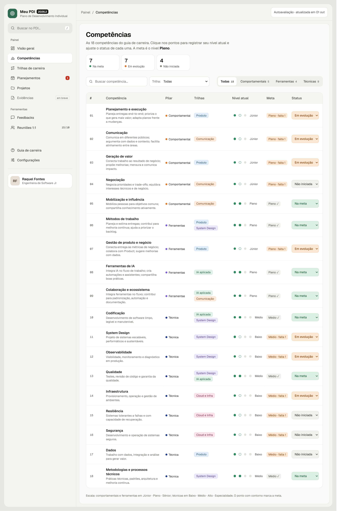
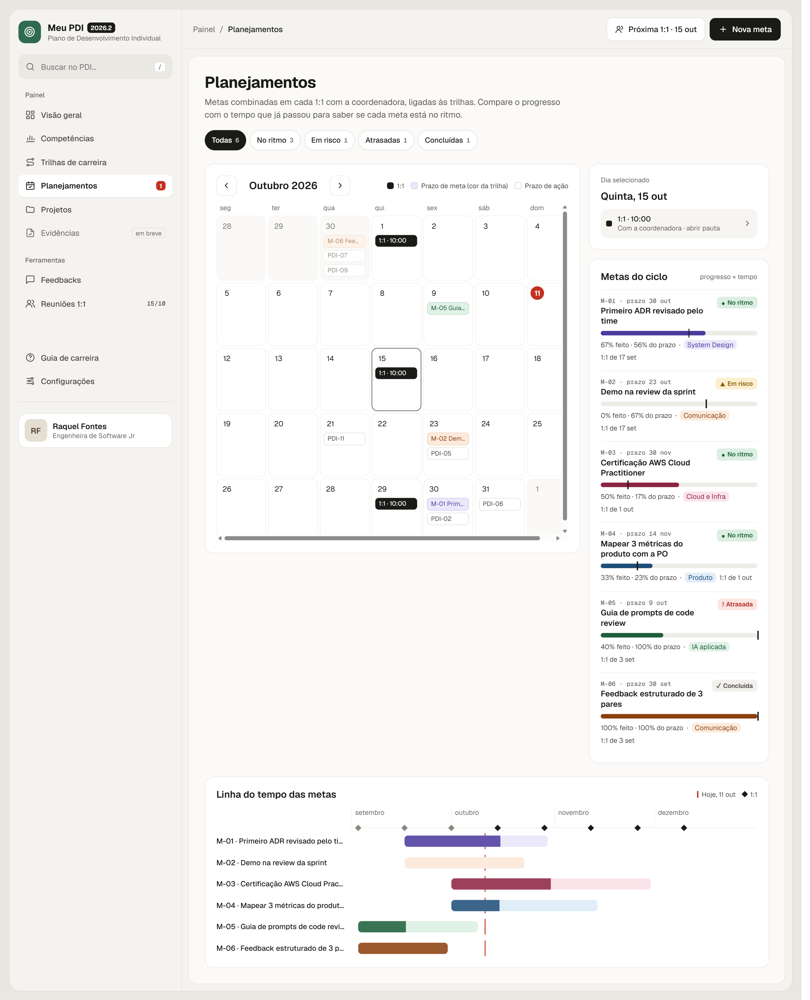
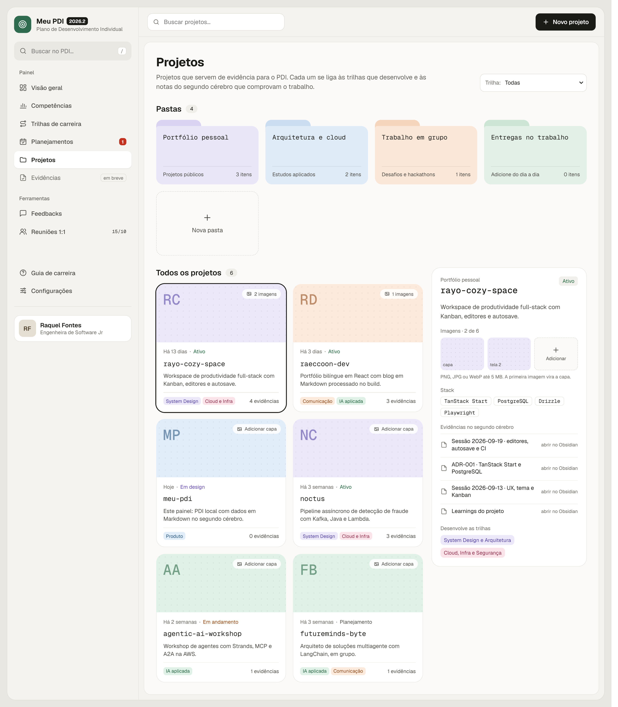
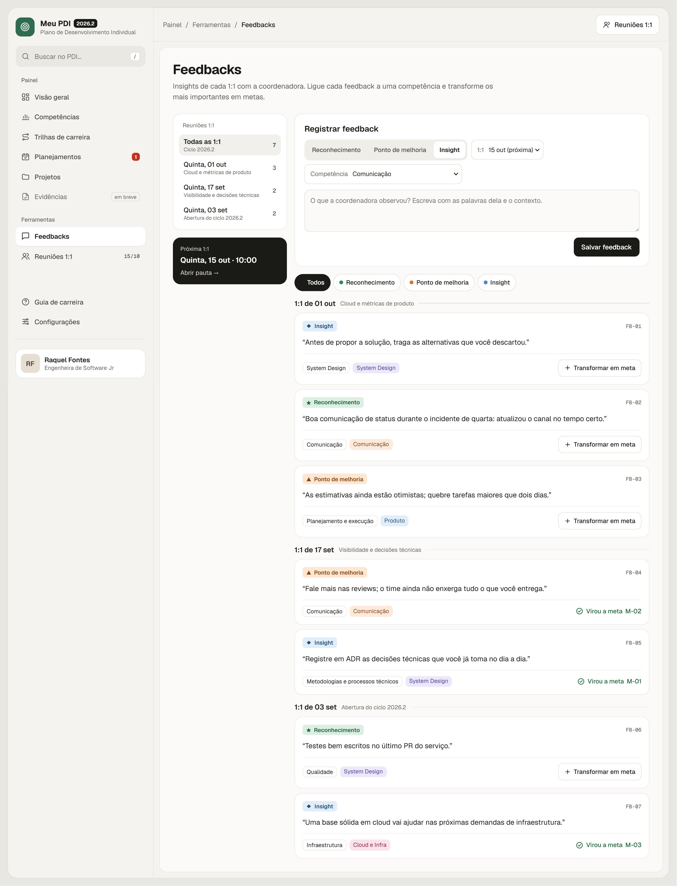

# meu-pdi


Painel local do Plano de Desenvolvimento Individual. A SPA React lê e grava
o PDI como notas Markdown dentro do vault do Obsidian; não há banco, nuvem
nem autenticação.

Contexto, arquitetura e decisões ficam no vault (`02 Projetos/meu-pdi/`):
Architecture.md e ADR-001 a ADR-005.

## Interface

Telas do System Design, na ordem da navegação lateral.

### Visão geral

KPIs do ciclo, pastas das trilhas, status por trilha, próxima 1:1, prazos e
últimos feedbacks.


### Competências

As 18 competências do framework com nível atual, meta, trilhas e status.



### Trilhas de carreira

Pastas T1…T5, detalhe da trilha selecionada e o quadro Kanban das ações.


### Planejamentos

Calendário mensal com 1:1s e prazos, painel do dia, metas da 1:1 e linha do
tempo das metas.



### Projetos

Pastas, lista e detalhe dos projetos usados como evidência do PDI.



### Feedbacks

Feedbacks das 1:1s agrupados por reunião, ligados a competências, trilhas e
metas.



### Reuniões 1:1

Agenda semanal, minicalendário do mês, pauta e metas da próxima 1:1 e
histórico das reuniões.


## Rodar

```bash
npm install
cp .env.example .env   # ajuste PDI_VAULT_DIR para o seu vault
npm run dev            # API em 127.0.0.1:5174 e Vite em 127.0.0.1:5173
```

Sem mexer no vault real, use os dados de exemplo do protótipo:

```bash
npm run dev:fixture
```

O catálogo do design system fica em `http://127.0.0.1:5173/_fundamentos`
(só em desenvolvimento).

Produção local: `npm run build && npm start` (um processo serve a API e o build).

## Qualidade

```bash
npm run check      # lint + typecheck + Vitest
npm run test:e2e   # Playwright em 375, 768 e 1440 px, com axe
```

O Playwright sobe o vault de fixture nas portas 5183 (Vite) e 5184 (API),
com `PDI_HOJE=2026-10-11`, então não reaproveita um `npm run dev` aberto no
vault real.

As baselines de screenshot (`tests/e2e/__screenshots__`) são geradas
localmente no Windows e não rodam no CI. Depois de uma mudança visual
intencional: `npx playwright test --update-snapshots`.

## Estrutura

- `src/domain/`: tipos, framework de competências, schemas Zod e regras puras
  (compartilhado entre navegador e servidor).
- `src/server/`: Hono em 127.0.0.1, leitura do vault com cache por mtime e
  proteção de Host/Origin.
- `src/web/`: React, componentes do design system (`components/`),
  tokens (`styles/tokens.css`) e as sete telas (`features/`), com filtros e
  seleção na URL. Nesta fase as telas só leem o vault; a escrita chega na
  Fase 4.
- `fixtures/vault/PDI/`: vault de exemplo usado em desenvolvimento e testes.

## Configuração

Só via ambiente do servidor (nunca `VITE_*`):

| Variável | Padrão | Uso |
|----------|--------|-----|
| `PDI_VAULT_DIR` | obrigatório | Caminho do vault |
| `PDI_DIR` | `03 Areas/Carreira/PDI` | Pasta do PDI, relativa ao vault |
| `PDI_PORT` | `5174` | Porta da API |
| `PDI_WEB_PORT` | `5173` | Porta do Vite em desenvolvimento |
| `PDI_HOJE` | data local | Data fixa para testes e demonstrações |
